# BÁO CÁO THUYẾT TRÌNH — BidNet: Sàn đấu giá sản phẩm trực tuyến

> **Mục đích tài liệu:** giúp bạn (1) hiểu toàn bộ hệ thống để trả lời giảng viên, (2) có slide + hình minh họa để vừa chiếu vừa nói, (3) tự chạy được dự án và demo trực tiếp.
>
> **Bộ tài liệu gồm:**
> | File | Dùng để |
> |---|---|
> | `BidNet-ThuyetTrinh-10-slide.pptx` | **File PowerPoint 10 slide** để nộp/thuyết trình — có sẵn ghi chú người nói ở khung Notes |
> | `preview/Slide 1..10.PNG` | Ảnh xem trước từng slide (không cần mở PowerPoint vẫn xem được) |
> | `BAO-CAO-THUYET-TRINH.md` (file này) | Học logic, tra cứu code, ôn câu hỏi phản biện |
> | `slides.html` | Bản 18 slide mở bằng trình duyệt (nếu muốn trình bày chi tiết hơn) |
> | `images/*.svg` (+ `.png`) | Hình minh họa: kiến trúc, ERD, vòng đời, luồng đặt giá, worker, JWT, SignalR, pipeline |
> | `demo-data.ps1` | Script tạo dữ liệu demo thật trước lớp (đăng ký → đăng sản phẩm → đặt giá → các ca lỗi) |
> | `make-pptx.ps1` | Script tạo lại file PPTX từ sơ đồ/ảnh (PowerPoint COM) |
> | `screenshots/` | Ảnh chụp hệ thống thật đang chạy (Swagger, response demo) |
>
> Đặc tả gốc của nhóm: `docs/BidNet-Backend-Specification.md` — mọi quy tắc BR-01…BR-17 bên dưới đều đối chiếu từ đó.

---

## 1. Giới thiệu đề tài

**BidNet là gì?** Back-end của một **sàn đấu giá sản phẩm trực tuyến**: người dùng đăng sản phẩm kèm thời gian mở/đóng phiên, người khác đặt giá tăng dần, hệ thống **tự động mở phiên, đóng phiên và chọn người thắng**, cập nhật giá **realtime** cho mọi người đang xem.

**Một phiên đấu giá = một sản phẩm = một người bán = tối đa một người thắng.**

### Phạm vi phiên bản 1 (đã làm)
- Đăng ký / đăng nhập / hồ sơ cá nhân (JWT).
- Xem, tìm kiếm, lọc, phân trang sản phẩm.
- Người bán tạo/sửa sản phẩm **trước khi phiên bắt đầu**.
- Đặt giá + lịch sử giá công khai (ẩn danh người đặt) + lịch sử cá nhân.
- Worker nền tự mở/đóng phiên theo giờ, chốt người thắng.
- Realtime SignalR: `BidAccepted`, `AuctionClosed`.
- Admin: xem/khóa/mở tài khoản, hủy phiên vi phạm (kèm lý do).
- Upload ảnh sản phẩm lên Cloudinary.
- OpenAPI/Swagger/Scalar, xử lý lỗi thống nhất, rate limit, log Serilog, 11 test tự động.

### Ngoài phạm vi (nói rõ để thầy không bắt bẻ)
- **Không có thanh toán thật** — `User.Balance` chỉ là cột chờ, chưa dùng (đặc tả mục 1.2).
- Không đấu giá tự động/mua ngay/trả giá kín, không chat, không login bên thứ ba.
- **Repo này chỉ có Back-end** — Frontend (nếu có) là dự án riêng chạy cổng 3000 (CORS `FrontendOnly` trong `appsettings.json`). Demo dùng Swagger UI.

---

## 2. Công nghệ sử dụng và VÌ SAO chọn

| Công nghệ | Phiên bản | Vai trò | Lý do chọn (trả lời thầy) |
|---|---|---|---|
| ASP.NET Core Web API | .NET 10 | Khung xương server | Hiệu năng cao, DI + middleware pipeline built-in, hợp mẫu REST |
| EF Core + SQL Server | 10.0.11 | ORM + database | Migration quản lý schema theo Git; `rowversion` hỗ trợ concurrency sẵn |
| JWT Bearer | 10.0.13 | Xác thực stateless | Server không lưu session; token ký số chứa Id + Role, hợp API nhiều client |
| PBKDF2 (Rfc2898DeriveBytes) | .NET built-in | Băm mật khẩu | Hàm băm **chậm chuyên dụng** 210.000 vòng + salt 16 byte, chống brute-force/rainbow table |
| SignalR | built-in | Realtime 2 chiều | WebSocket tự động fallback, có Groups theo phiên, tích hợp JWT |
| CloudinaryDotNet | 1.29.3 | Lưu ảnh | DB chỉ lưu metadata; CDN phục vụ ảnh nhanh, không phình database |
| Serilog | 10.0.0 | Log | Ghi console + file cuộn ngày, structured log, TraceId đối chiếu lỗi |
| OpenAPI + SwaggerUI + Scalar | 10.x | Tài liệu API | Tự sinh tài liệu từ code, thử API ngay trên trình duyệt (chỉ bật ở Development) |
| xUnit + Moq + EF InMemory | — | Kiểm thử | Test nghiệp vụ không cần SQL; test concurrency riêng chạy SQL thật |
| RateLimiter | built-in | Chống spam | Fixed window theo IP (auth) / theo user (bid), trả 429 không xếp hàng |

---

## 3. Kiến trúc tổng thể

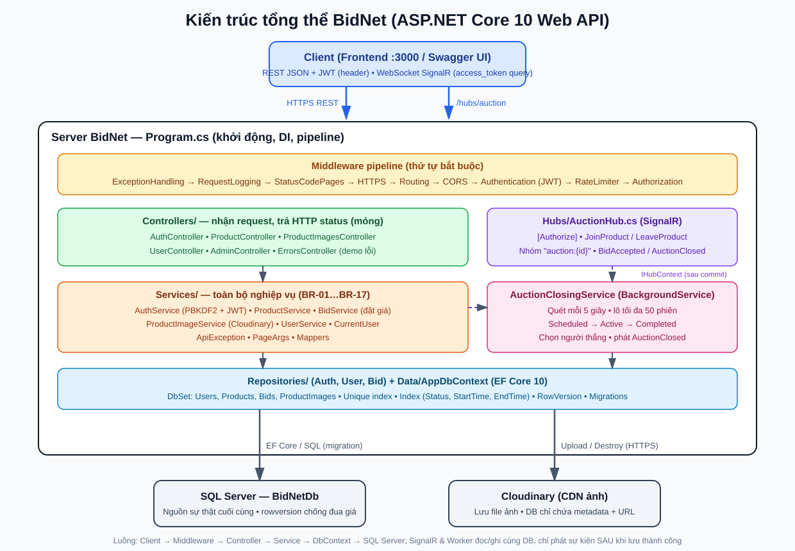

### Phân lớp (layered architecture) — request đi từ trên xuống

```
Client ──HTTPS──> Middleware pipeline ──> Controllers ──> Services ──> Repositories / AppDbContext ──> SQL Server
                                                            │
                                                            ├──(IHubContext)──> AuctionHub ──WebSocket──> Client
                                                            └── ProductImageService ──HTTPS──> Cloudinary
Worker nền (AuctionClosingService) ──scope riêng──> AppDbContext ──> SQL Server
```

| Lớp | Thư mục | Nguyên tắc |
|---|---|---|
| Presentation | `Controllers/`, `Hubs/` | **Mỏng**: nhận request, ràng buộc DTO, gọi service, trả status. Không chứa nghiệp vụ |
| Business | `Services/` | **Toàn bộ quy tắc BR-01…BR-17 nằm đây**. Ném `ApiException(status, code, message)` khi vi phạm |
| Data access | `Repositories/`, `Data/AppDbContext.cs` | Truy vấn + cấu hình EF (index, quan hệ, concurrency). `SaveChanges` thống nhất trong service |
| Domain | `Models/` | 4 entity ánh xạ 4 bảng |
| Contract | `DTOs/` | Tách entity khỏi API — **không lộ PasswordHash/RowVersion**, lịch sử công khai ẩn UserId |
| Cross-cutting | `Middleware/`, `Program.cs` | Xử lý lỗi toàn cục, log request, JWT, CORS, rate limit |

**Điểm đáng nhớ:** `BidService` **cố tình không dùng BidRepository** mà dùng thẳng `AppDbContext` (comment trong `Repositories/BidRepository.cs`) — vì INSERT Bid và UPDATE `Product.CurrentPrice` phải nằm trong **một `SaveChanges` = một transaction** (BR-11). Repository CRUD tách rời sẽ phá vỡ tính atomic đó.

**Điểm khởi động `Program.cs`** (đọc theo thứ tự dòng):
- 19–34: Serilog bootstrap.
- 83–86: đọc connection string từ User Secrets/env — thiếu là dừng.
- 90–121: JWT key ≥ 32 byte mới cho chạy; cấu hình validate chữ ký/issuer/audience/hạn; `OnMessageReceived` đọc `access_token` trên query **chỉ cho** `/hubs/auction` (WebSocket không gắn header được).
- 126–136: CORS chỉ cho `FrontendUrl` (mặc định `http://localhost:3000`).
- 140–155: 2 policy rate limit `auth` (10/phút/IP) và `bid` (30/phút/user).
- 159–180: đăng ký DI (Scoped cho service/repo, Singleton cho Cloudinary, HostedService cho worker).
- 184–225: ghép pipeline (xem mục 7).

---

## 4. Cơ sở dữ liệu

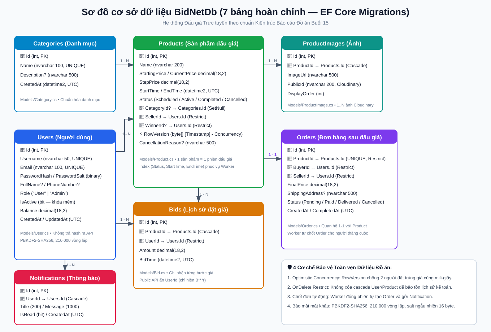

7 bảng hoàn chỉnh, cấu hình trong `Data/AppDbContext.cs`, entity trong `Models/`:

| Bảng | Entity | Cột đáng chú ý |
|---|---|---|
| `Users` | `Models/User.cs` | Username/Email **unique index**; `PasswordHash`+`PasswordSalt` (binary, không trả API); `Role` ("User"/"Admin"); `IsActive` (khóa mềm); `Balance` (chưa dùng) |
| `Products` | `Models/Product.cs` | `StartingPrice`/`CurrentPrice` **decimal(18,2)**; `StartTime`/`EndTime` UTC; `Status` enum; `SellerId` (FK), `WinnerId?` (FK); **`[Timestamp] RowVersion`** (dòng 56–57); `CancellationReason?`; `CategoryId?` (FK SetNull); index `(Status, StartTime, EndTime)` |
| `Bids` | `Models/Bid.cs` | `ProductId` FK (Cascade), `UserId` FK (Restrict), `Amount` decimal, `BidTime` UTC; index `(ProductId, BidTime)` |
| `ProductImages` | `Models/ProductImage.cs` | `CloudinaryPublicId` (để xóa), `CloudinaryUrl` (CDN), `ProductId?` (SetNull) — **file nhị phân không nằm trong DB** |
| `Categories` | `Models/Category.cs` | `Id` (PK), `Name` (UNIQUE), `Description` — Chuẩn hóa danh mục sản phẩm (1-N với Products) |
| `Orders` | `Models/Order.cs` | `Id` (PK), `ProductId` (UNIQUE FK 1-1), `BuyerId` (FK), `SellerId` (FK), `FinalPrice`, `Status` (Pending/Paid/Delivered/Cancelled) — Đơn hàng tự động sau khi kết thúc phiên |
| `Notifications` | `Models/Notification.cs` | `Id` (PK), `UserId` (FK Cascade), `Title`, `Message`, `IsRead`, `CreatedAt` — Thông báo vượt giá (outbid) và chốt đơn đấu giá |

### Quyết định thiết kế phải giải thích được
1. **Tiền dùng `decimal`, không `float/double`** — float sai số nhị phân, cộng dồn tiền sẽ lệch (BR-02).
2. **Enum lưu số cố định:** `Active=0, Completed=1, Cancelled=2, Scheduled=3` (`Models/Product.cs` dòng 68–76) — không đổi giá trị số khi chưa migration, dù thứ tự vòng đời là Scheduled→Active→Completed.
3. **Delete behavior:** Seller/Winner/User của Bid = **Restrict** (không xóa cứng người đã tham gia phiên, tránh cascade vòng); Bid theo Product = Cascade; Image theo Product = SetNull; Category theo Product = SetNull.
4. **Unique index Username/Email và Category Name** — chặn trùng ở tầng DB kể cả 2 request đồng thời; bắt `SqlException 2601/2627` → 409.
5. **Index `(Status, StartTime, EndTime)`** — worker quét "Scheduled đến giờ mở" / "Active quá giờ đóng" dùng index này, không quét cả bảng.
6. **Khép kín vòng đời với Orders & Notifications** — khi worker đóng phiên, nếu có người thắng thì tự động tạo `Order` trạng thái `Pending` và bắn 2 thông báo cho Buyer và Seller; khi người khác trả giá cao hơn, `BidService` bắn thông báo outbid cho bidder trước đó.
7. **5 migrations** (`Migrations/`): `InitialCreate` → `AuctionWorkflow` → `AddProductImages` → `UseCloudinaryStorage` → `AddCategoriesOrdersNotifications`. Máy mới chỉ chạy `dotnet ef database update`, **không tạo lại migration**.

---

## 5. Vòng đời phiên đấu giá

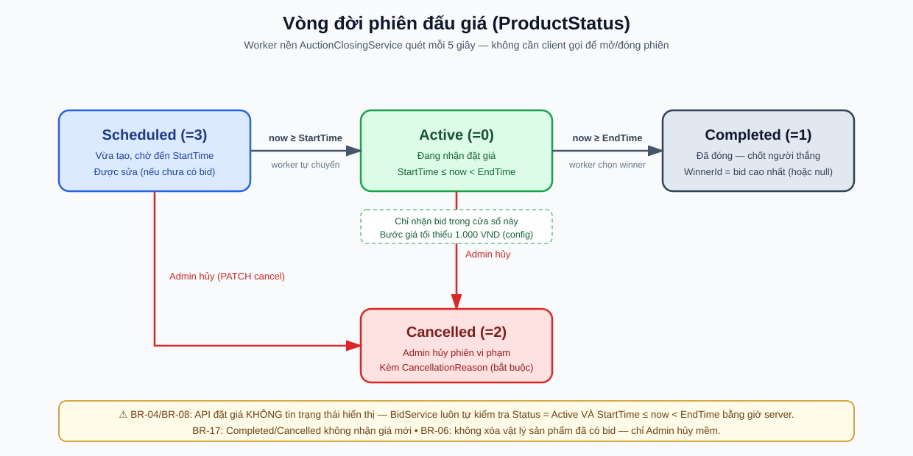

```
Scheduled ──(worker: now ≥ StartTime)──> Active ──(worker: now ≥ EndTime, chọn winner)──> Completed
    │                                       │
    └────────── Admin hủy (lý do) ──────────┴──────────> Cancelled
```

- **BR-04/BR-08 (quan trọng nhất):** worker quét 5 giây/lần nên trạng thái có thể trễ vài giây. Vì vậy `BidService.PlaceAsync` **luôn tự kiểm tra** `Status == Active && StartTime <= now < EndTime` bằng `DateTime.UtcNow` của server — không tin trạng thái hiển thị phía client.
- **BR-05:** chỉ sửa sản phẩm khi `Scheduled` **và chưa đến StartTime và chưa có bid** (`ProductService.UpdateAsync` dòng 92–94 → 409 `auction_started`).
- **BR-06/BR-17:** không xóa vật lý sản phẩm đã có bid; phiên Completed/Cancelled không nhận giá; Admin hủy mềm kèm `CancellationReason`.

---

## 6. Các luồng nghiệp vụ chi tiết (kèm vị trí code)

### 6.1 Đăng ký / Đăng nhập / JWT

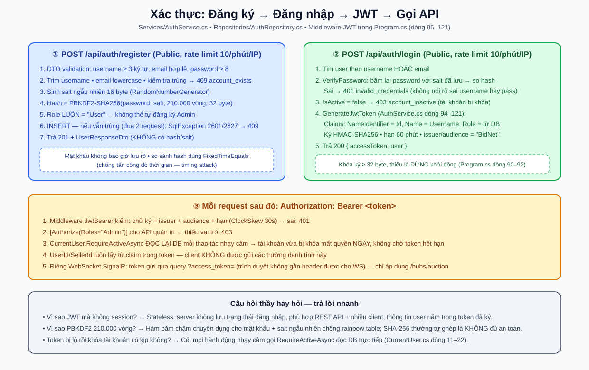

**Đăng ký** — `POST /api/auth/register` → `AuthController` → `AuthService.RegisterAsync` (`Services/AuthService.cs` dòng 37–70):
1. DTO validate (`DTOs/UsersDto.cs`): username 3–50 ký tự, email hợp lệ, password ≥ 8.
2. Trim username, lowercase email; kiểm tra trùng qua `AuthRepository.ExistsByUsernameOrEmailAsync` → 409 `account_exists`.
3. Salt 16 byte ngẫu nhiên mật mã học; hash = **PBKDF2-SHA256, 210.000 vòng, output 32 byte** (dòng 144–145).
4. `Role = "User"` cứng — **không thể tự đăng ký Admin** (Admin đầu tiên tạo bằng thao tác DBA trên SQL Server, theo README).
5. INSERT; nếu đua 2 request cùng username → unique index chặn, bắt SqlException 2601/2627 → 409 (dòng 62–67).
6. Trả 201 + `UserResponseDto` (không hash/salt/balance).

**Đăng nhập** — `POST /api/auth/login` → `AuthService.LoginAsync` (dòng 73–91):
1. Tìm theo username **hoặc** email.
2. `VerifyPassword` băm lại với salt đã lưu, so sánh **`CryptographicOperations.FixedTimeEquals`** (chống timing attack). Sai → 401 `invalid_credentials` (không tiết lộ sai username hay password).
3. `IsActive == false` → 403 `account_inactive`.
4. `GenerateJwtToken` (dòng 94–121): claims `NameIdentifier=Id`, `Name=Username`, `Role từ DB`; ký **HMAC-SHA256**; hạn 60 phút (`Jwt:ExpireMinutes`); issuer/audience "BidNet".
5. Trả `{ accessToken, user }`. Client gửi `Authorization: Bearer <token>` cho request sau.

**Mỗi request nhạy cảm** — `CurrentUser.RequireActiveAsync` (`Services/CurrentUser.cs` dòng 11–22): lấy Id **từ claim** (không nhận client gửi), **đọc lại DB** kiểm tra tồn tại + `IsActive`. → Tài khoản bị Admin khóa **mất quyền ngay lập tức** dù JWT còn hạn 60 phút. Đây là câu trả lời cho "khóa tài khoản có kịp không khi token chưa hết hạn?".

### 6.2 Đăng / sửa / xem sản phẩm

`Services/ProductService.cs`:
- **CreateAsync** (57–80): `SellerId` lấy từ token (BR-01); sản phẩm mới `Status=Scheduled`, `CurrentPrice=StartingPrice`.
- **Validate** (135–150): tên bắt buộc ≤200; giá **nguyên VND ≥ 1.000** (chặn số thập phân bằng `decimal.Truncate`); `StartTime > now`, `EndTime > StartTime`, cả hai **DateTimeKind.Utc**; ImageUrl phải absolute http/https.
- **UpdateAsync** (82–112): không phải chủ → 403 `not_owner`; không còn Scheduled/đã đến giờ/đã có bid → 409 `auction_started`; conflict RowVersion → 409 `product_changed` (106–110). Không cho đổi SellerId/WinnerId/CurrentPrice (BR-05).
- **ListAsync** (11–37): lọc `q` (tên chứa), `category`, `status` (parse enum sai → 400), khoảng giá trên **CurrentPrice**; phân trang `PageArgs.Validate`: page ≥ 1, pageSize 1–100 (mặc định 20); sort ổn định `CreatedAt desc, Id desc`; `AsNoTracking` cho query đọc.
- **GetAsync** (49–55): Include Seller/Winner để mapper hiện tên; 404 nếu không có.

### 6.3 Đặt giá — luồng QUAN TRỌNG NHẤT (thầy chắc chắn hỏi)

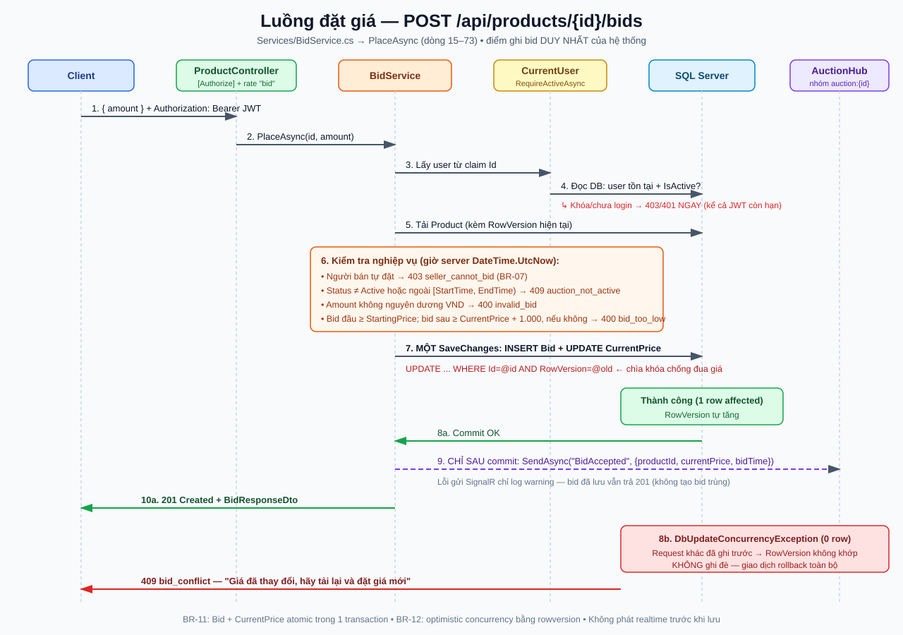

`POST /api/products/{id}/bids` → `ProductController.PlaceBid` (dòng 51–60, `[Authorize]` + rate limit "bid" 30/phút) → **`BidService.PlaceAsync`** (`Services/BidService.cs` dòng 15–73) — điểm ghi bid **duy nhất**:

| Bước | Code (dòng) | Quy tắc | Lỗi trả về |
|---|---|---|---|
| 1 | 19 | `RequireActiveAsync` — đọc DB kiểm tra active | 401 / 403 `account_inactive` |
| 2 | 20–21 | Tải Product | 404 `product_not_found` |
| 3 | 23–24 | Người bán không tự đặt (BR-07) | 403 `seller_cannot_bid` |
| 4 | 25–26 | `Status==Active` và `StartTime ≤ now < EndTime` (BR-08) | 409 `auction_not_active` |
| 5 | 30–34 | Bước giá từ config `Auction:MinBidIncrement`=1000; amount nguyên dương VND (BR-09/10) | 400 `invalid_bid` |
| 6 | 36–41 | Bid đầu ≥ StartingPrice; bid sau ≥ CurrentPrice + 1000 | 400 `bid_too_low` |
| 7 | 43–51 | **Một SaveChanges**: INSERT Bid + UPDATE CurrentPrice + UpdatedAt (BR-11) | — |
| 8 | 53–57 | `DbUpdateConcurrencyException` → **409 `bid_conflict`**, không ghi đè (BR-12) | 409 |
| 9 | 61–71 | **Sau commit** mới phát SignalR `BidAccepted`; lỗi gửi chỉ log warning | — |
| 10 | 72 | Trả 201 + BidResponseDto | — |

**Cơ chế chống đua giá (optimistic concurrency) — giải thích được từng chữ:**
- `Product.RowVersion` là `[Timestamp]` → SQL Server tự đổi giá trị mỗi UPDATE.
- EF sinh câu `UPDATE Products SET ... WHERE Id = @id AND RowVersion = @giá_trị_cũ`.
- Hai người cùng đặt giá dựa trên `CurrentPrice = 100.000`: cả hai đọc cùng RowVersion. Request A commit trước → RowVersion đổi. Câu UPDATE của B khớp **0 dòng** → EF ném `DbUpdateConcurrencyException` → B nhận **409**, toàn bộ transaction của B rollback (không có chuyện Bid của B lưu mà CurrentPrice không đổi).
- Client nhận 409 → tải lại giá mới → đặt lại. **Không bao giờ ghi đè giá thấp hơn giá đã lưu.**
- Chứng minh bằng test thật: `Tests/SqlConcurrencyTests.cs` — `StaleBid_CannotOverwriteCommittedPrice` chạy trên SQL Server thật (InMemory không mô phỏng rowversion).

**Lịch sử giá:** `ForProductAsync` (75–93) công khai, **ẩn UserId** (`PublicBidDto`), sort `BidTime desc, Id desc`; `MineAsync` (95–100) chỉ lọc theo user trong token. Bid đã lưu **không sửa/xóa qua API** (BR-13).

### 6.4 Worker nền mở/đóng phiên — chọn người thắng

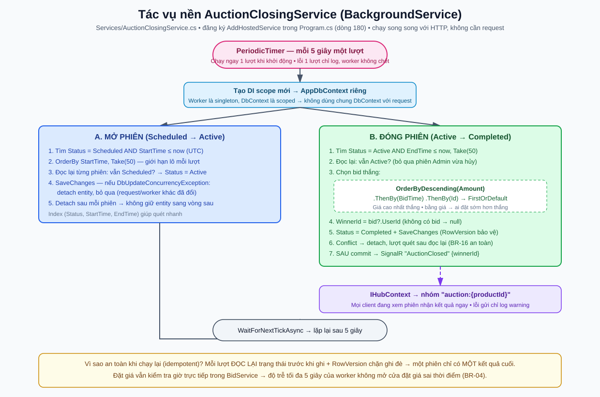

`Services/AuctionClosingService.cs` — `BackgroundService`, đăng ký `AddHostedService` (Program.cs dòng 180):
- `PeriodicTimer` **5 giây/lượt**, chạy ngay 1 lượt khi khởi động; lỗi 1 lượt chỉ log, worker không chết (14–30).
- Mỗi lượt **tạo DI scope mới** vì worker là singleton còn DbContext là scoped (36–37).
- **Mở phiên** (41–55): tìm `Scheduled && StartTime <= now`, Take(50); đọc lại từng phiên, vẫn Scheduled thì đổi Active; conflict → detach bỏ qua.
- **Đóng phiên** (58–94): tìm `Active && EndTime <= now`, Take(50); chọn bid thắng:
  ```csharp
  OrderByDescending(b => b.Amount).ThenBy(b => b.BidTime).ThenBy(b => b.Id).FirstOrDefault()
  ```
  → **giá cao nhất thắng; bằng giá thì ai đặt sớm hơn thắng; Id phá hòa cuối cùng**. `WinnerId = winningBid?.UserId` — **không có bid → null** (BR-15). Đổi Completed, SaveChanges; conflict → detach, lượt sau xử lý lại (BR-16 idempotent).
- Sau commit → phát `AuctionClosed { productId, status, winnerId }` cho nhóm đang xem.

### 6.5 Realtime SignalR

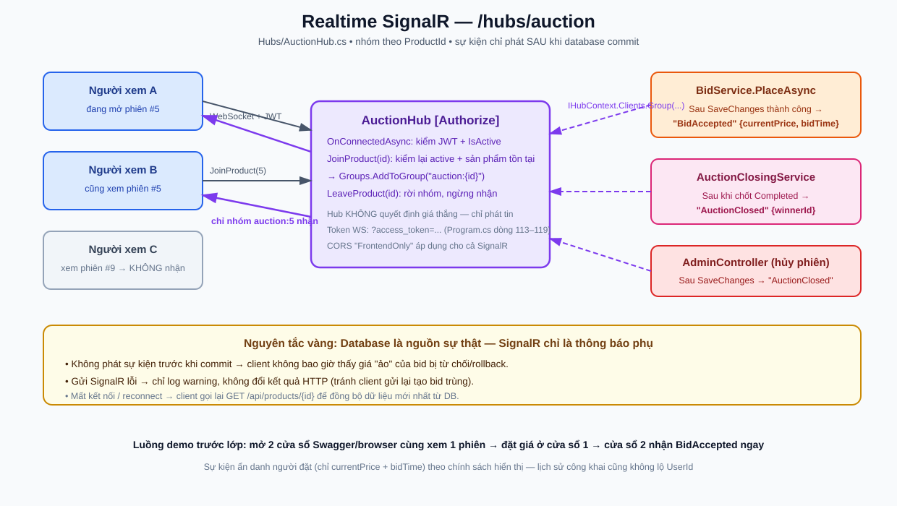

`Hubs/AuctionHub.cs` — `[Authorize]`, endpoint `/hubs/auction`:
- Kết nối: JWT qua query `?access_token=` (Program.cs 113–119 chỉ cho phép riêng hub này).
- `OnConnectedAsync` + `JoinProduct(id)`: gọi `RequireActiveAsync` **kiểm tra lại DB** (chặn tài khoản vừa bị khóa), kiểm tra sản phẩm tồn tại rồi mới vào nhóm `auction:{id}`.
- `LeaveProduct(id)`: rời nhóm.
- **Hub không quyết định nghiệp vụ** — chỉ nhận lệnh nhóm và là nơi `IHubContext` gửi tới. Người gửi: `BidService` (BidAccepted), `AuctionClosingService` + `AdminController` (AuctionClosed).
- Nguyên tắc: **DB là nguồn sự thật, SignalR là thông báo phụ** — chỉ phát sau commit; lỗi gửi không đổi kết quả HTTP; client reconnect phải gọi lại `GET /api/products/{id}`.

### 6.6 Admin

`Controllers/AdminController.cs` — `[Authorize(Roles = "Admin")]` toàn controller:
- `GET /api/admin/users`: `UserService.GetAllAsync` → `UserRepository.GetAllAsync` (search username/email, lọc Role, sort, phân trang tối đa 50).
- `PATCH /api/admin/users/{id}/status`: khóa/mở mềm `IsActive`; **không được tự khóa chính mình** → 400 `cannot_disable_self`. Người bị khóa: token còn hạn vẫn bị `RequireActiveAsync` chặn ngay ở mọi hành động nhạy cảm.
- `PATCH /api/admin/products/{id}/cancel`: bắt buộc `reason` (400 nếu thiếu); phiên Completed/Cancelled → 409 `auction_closed`; conflict RowVersion → 409 `product_changed`; lưu xong phát `AuctionClosed`.

### 6.7 Upload ảnh sản phẩm (Cloudinary)

`Controllers/ProductImagesController.cs` + `Services/ProductImageService.cs`:
- `POST /api/products/{id}/images` (multipart): kiểm tra active user → sản phẩm tồn tại (404) → **đúng chủ** (403) → MIME whitelist jpeg/png/webp/gif (400) → **≤ 5MB** (400) → upload Cloudinary folder `bidnet/products/{id}`, transform `Quality(auto).FetchFormat(auto)` → lỗi Cloudinary 502 → lưu metadata + cập nhật `Product.ImageUrl` = ảnh mới nhất trong **một SaveChanges**.
- `GET /api/products/{id}/images`: danh sách metadata (public).
- `GET /api/product-images/{id}`: tải bytes từ CDN qua `IHttpClientFactory`, trả file.
- `DELETE /api/product-images/{id}`: chủ sở hữu → **xóa trên Cloudinary trước, rồi xóa row DB** → 204.

---

## 7. Middleware, bảo mật, xử lý lỗi

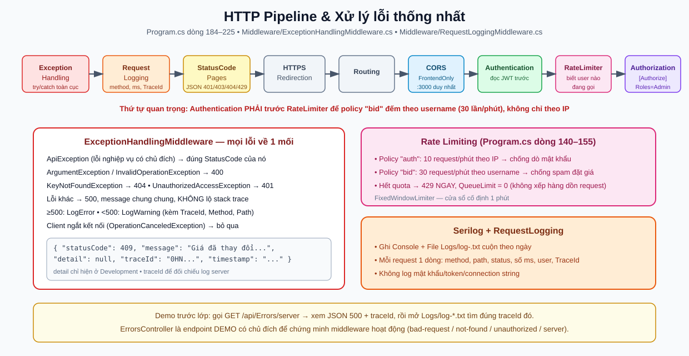

**Thứ tự pipeline (Program.cs 184–225) — học thuộc:**
```
ExceptionHandling → RequestLogging → StatusCodePages → HttpsRedirection
→ [Development: OpenAPI/Scalar/SwaggerUI] → Routing → CORS("FrontendOnly")
→ Authentication → RateLimiter → Authorization → MapControllers + MapHub
```
- **Authentication trước RateLimiter**: policy "bid" đếm theo `User.Identity.Name` — phải đọc JWT trước mới biết user nào.
- **ExceptionHandling ngoài cùng**: bắt mọi lỗi chưa xử lý.

**Xử lý lỗi thống nhất** (`Middleware/ExceptionHandlingMiddleware.cs`):
- `ApiException` (lỗi nghiệp vụ chủ đích, có `code` ổn định như `bid_too_low`) → đúng status của nó.
- `ArgumentException`/`InvalidOperationException` → 400; `KeyNotFoundException` → 404; `UnauthorizedAccessException` → 401; còn lại → 500 message chung, **không lộ stack trace cho client** (detail chỉ hiện ở Development).
- JSON lỗi: `{ statusCode, message, detail, traceId, timestamp }` — `traceId` = `HttpContext.TraceIdentifier` để đối chiếu log.
- Lỗi 401/403/404/429 phát sinh **ngoài controller** (middleware auth, rate limiter) được `UseStatusCodePages` bồi thêm JSON `ProblemDetails` (Program.cs 189–205).
- `ErrorsController` (`/api/Errors/bad-request|not-found|unauthorized|server`) là endpoint **demo cố tình ném lỗi** để chứng minh middleware — dùng lúc thuyết trình rất trực quan.

**Bảo mật:**
- Secrets (connection string, JWT key, Cloudinary) nằm trong **User Secrets từng máy / biến môi trường**, không commit Git (`UserSecretsId` trong csproj chỉ là mã định danh).
- JWT key < 32 byte → **dừng khởi động** (Program.cs 90–92).
- Rate limit: auth 10/phút/IP (chống dò mật khẩu), bid 30/phút/user (chống spam); hết quota trả **429 ngay**, `QueueLimit=0`.
- CORS chỉ 1 origin frontend; HTTPS redirect; không log mật khẩu/token.
- Server luôn tự quyết định: `SellerId`, `UserId`, `Status`, `CurrentPrice`, `WinnerId`, `BidTime` — **không nhận từ request**.
- ⚠️ Điểm cần biết (nếu thầy hỏi về cấu hình): `appsettings.json` hiện vẫn chứa một JWT key mặc định làm fallback — README yêu cầu mỗi máy đặt key riêng qua user-secrets; khi triển khai thật phải bỏ key mặc định này.

---

## 8. Bảng API đầy đủ (hợp đồng phiên bản 1)

| Method | Route | Quyền | Chức năng |
|---|---|---|---|
| POST | `/api/auth/register` | Public (rate auth) | Đăng ký → 201 |
| POST | `/api/auth/login` | Public (rate auth) | Đăng nhập → 200 + JWT |
| GET | `/api/users/me` | User/Admin | Hồ sơ cá nhân |
| PUT | `/api/users/me` | User/Admin | Sửa FullName/PhoneNumber |
| GET | `/api/users/me/bids` | User/Admin | Lịch sử đặt giá của tôi |
| GET | `/api/products` | Public | Danh sách: q, category, status, minPrice, maxPrice, page, pageSize |
| GET | `/api/products/{id}` | Public | Chi tiết phiên (kèm sellerName/winnerName) |
| GET | `/api/products/me` | User/Admin | Sản phẩm tôi đã đăng |
| POST | `/api/products` | User/Admin | Tạo phiên → 201 + Location |
| PUT | `/api/products/{id}` | Chủ sản phẩm | Sửa khi Scheduled + chưa bid |
| POST | `/api/products/{id}/bids` | User/Admin (rate bid) | Đặt giá → 201 / 400 / 403 / 409 |
| GET | `/api/products/{id}/bids` | Public | Lịch sử giá công khai (ẩn UserId) |
| POST | `/api/products/{id}/images` | Chủ sản phẩm | Upload ảnh (multipart, ≤5MB) |
| GET | `/api/products/{id}/images` | Public | Danh sách ảnh |
| GET | `/api/product-images/{id}` | Public | Tải file ảnh |
| DELETE | `/api/product-images/{id}` | Chủ sản phẩm | Xóa ảnh → 204 |
| GET | `/api/admin/users` | Admin | Danh sách tài khoản (search/filter/sort, pageSize ≤ 50) |
| PATCH | `/api/admin/users/{id}/status` | Admin | Khóa/mở tài khoản |
| PATCH | `/api/admin/products/{id}/cancel` | Admin | Hủy phiên + lý do |
| GET | `/api/Errors/*` | Public | Demo middleware lỗi |
| WS | `/hubs/auction?access_token=` | User/Admin | JoinProduct/LeaveProduct; nhận BidAccepted/AuctionClosed |

Mã lỗi: 400 dữ liệu sai • 401 chưa đăng nhập • 403 không quyền/bị khóa • 404 không thấy • 409 trùng lặp/giá lỗi thời/phiên đổi trạng thái • 429 quá tần suất • 500 lỗi server (ẩn chi tiết).

---

## 9. BẢN ĐỒ CODE — "chỗ nào, làm gì" (tra nhanh khi thầy hỏi)

| Câu hỏi | File | Dòng |
|---|---|---|
| Khởi động, DI, pipeline? | `Program.cs` | toàn bộ (184–225 pipeline) |
| Cấu hình JWT, đọc token WS? | `Program.cs` | 90–121 |
| Rate limit auth/bid? | `Program.cs` | 140–155 |
| Đăng ký, hash PBKDF2? | `Services/AuthService.cs` | 37–70, 144–145 |
| Đăng nhập, tạo JWT? | `Services/AuthService.cs` | 73–91, 94–121 |
| So sánh hash chống timing attack? | `Services/AuthService.cs` | 124–142 |
| Kiểm tra tài khoản active mỗi request? | `Services/CurrentUser.cs` | 11–22 |
| Tạo sản phẩm, SellerId từ token? | `Services/ProductService.cs` | 57–80 |
| Validate giá/thời gian/ảnh? | `Services/ProductService.cs` | 135–150 |
| Quy tắc sửa: Scheduled + chưa bid? | `Services/ProductService.cs` | 92–94 |
| Conflict sửa sản phẩm → 409? | `Services/ProductService.cs` | 106–110 |
| **Đặt giá: toàn bộ quy tắc?** | `Services/BidService.cs` | **15–73** |
| **RowVersion conflict → 409 bid_conflict?** | `Services/BidService.cs` | **53–57** |
| Lịch sử công khai ẩn UserId? | `Services/BidService.cs` | 75–93 |
| Khai báo RowVersion? | `Models/Product.cs` | 56–57 |
| Enum trạng thái (giá trị số)? | `Models/Product.cs` | 68–76 |
| Worker 5s, mở phiên? | `Services/AuctionClosingService.cs` | 14–55 |
| **Chọn người thắng (cao nhất, sớm hơn)?** | `Services/AuctionClosingService.cs` | **65–70** |
| Phát AuctionClosed sau commit? | `Services/AuctionClosingService.cs` | 83–93 |
| Hub, nhóm theo phiên? | `Hubs/AuctionHub.cs` | 14–35 |
| Admin khóa tài khoản (không tự khóa)? | `Controllers/AdminController.cs` | 35–50 |
| Admin hủy phiên + conflict? | `Controllers/AdminController.cs` | 53–88 |
| Upload Cloudinary, giới hạn 5MB/MIME? | `Services/ProductImageService.cs` | 17–87 |
| Index, quan hệ, delete behavior? | `Data/AppDbContext.cs` | 24–73 |
| Middleware lỗi → JSON + traceId? | `Middleware/ExceptionHandlingMiddleware.cs` | 45–100 |
| Log mỗi request (ms, user, traceId)? | `Middleware/RequestLoggingMiddleware.cs` | 22–41 |
| Phân trang page≥1, pageSize≤100? | `Services/PageArgs.cs` | 9–11 |
| Test nghiệp vụ InMemory? | `Tests/AuctionRulesTests.cs` | 10 test |
| Test đua giá SQL thật? | `Tests/SqlConcurrencyTests.cs` | 56–72 |
| Bước giá 1000 cấu hình ở đâu? | `appsettings.json` | `Auction:MinBidIncrement` |

---

## 10. Kiểm thử

`Tests/BidNet.Tests.csproj` — xUnit + Moq + EF InMemory, **11 test**:

**10 test InMemory** (`AuctionRulesTests.cs`) — mỗi test một DB GUID riêng, fake HttpContext gắn claim Id, mock SignalR:
1. Hash mật khẩu ≠ plaintext; login OK; user bị khóa → 403.
2. Trùng username/email → 409.
3. Giá thập phân → 400; SellerId lấy từ identity; mới tạo = Scheduled, CurrentPrice = StartingPrice.
4. Người bán tự đặt → 403; bid đầu = giá khởi điểm OK; +500 (< bước 1000) → 400, DB không đổi.
5. Người khác sửa → 403; phiên Active sửa → 409.
6. Bid phiên hết hạn → 409; giá thập phân → 400.
7. Tài khoản khóa đặt giá → 403; phiên chưa mở → 409.
8. Phân trang + lọc status đúng TotalCount.
9. **Worker thật** chạy trong test: đóng phiên hết hạn, WinnerId = người đặt cao nhất.
10. Update profile qua repository.

**1 test SQL Server thật** (`SqlConcurrencyTests.cs` — `StaleBid_CannotOverwriteCommittedPrice`): chỉ chạy khi bật `BIDNET_TEST_SQL=1`; tạo DB tạm `BidNet_Test_<guid>`, 2 DbContext cùng đọc 1 RowVersion → cái thứ hai SaveChanges phải ném `DbUpdateConcurrencyException`; xóa DB tạm sau test. **Lý do tách riêng: InMemory không thi hành rowversion.**

Chạy: `dotnet test Tests/BidNet.Tests.csproj`

---

## 11. Chạy dự án trên máy của bạn (từng bước)

**Yêu cầu:** .NET SDK 10, SQL Server (máy này đang có `SQLEXPRESS` chạy sẵn).

```powershell
cd D:\all_my_project\BidNet
dotnet tool restore
dotnet restore BidNet.csproj

# 1. Chuỗi kết nối (máy này dùng SQLEXPRESS + Windows Auth)
dotnet user-secrets set "ConnectionStrings:DefaultConnection" "Server=.\SQLEXPRESS;Database=BidNetDb;Trusted_Connection=True;TrustServerCertificate=True;" --project BidNet.csproj

# 2. Khóa JWT riêng (khuyến nghị theo README)
$k = [Convert]::ToBase64String([System.Security.Cryptography.RandomNumberGenerator]::GetBytes(48))
dotnet user-secrets set "Jwt:Key" $k --project BidNet.csproj

# 3. Cloudinary (nếu chưa có — bắt buộc, thiếu là server không khởi động)
dotnet user-secrets set "Cloudinary:CloudName" "<tên>" --project BidNet.csproj
dotnet user-secrets set "Cloudinary:ApiKey" "<key>" --project BidNet.csproj
dotnet user-secrets set "Cloudinary:ApiSecret" "<secret>" --project BidNet.csproj

# 4. Tạo/cập nhật DB từ migration có sẵn (KHÔNG migrations add InitialCreate)
dotnet ef database update --project BidNet.csproj

# 5. Tin cậy chứng chỉ HTTPS dev (1 lần, hộp thoại hiện lên bấm Yes)
dotnet dev-certs https --trust

# 6. Chạy
dotnet run --project BidNet.csproj --launch-profile https
```

Mở: **https://localhost:7010/swagger** (thử API) • `/scalar` (tài liệu đẹp) • `/openapi/v1.json`.
Cổng: https 7010, http 5014 (`Properties/launchSettings.json`).

**Cách thử API trong Swagger (kịch bản demo):**
1. `POST /api/auth/register` tạo 2 tài khoản (seller + bidder).
2. `POST /api/auth/login` → copy `accessToken` → bấm **Authorize** dán token (không cần gõ chữ Bearer).
3. `POST /api/products` với `startTime` = hiện tại + 30 giây, `endTime` = + 10 phút (giờ UTC, đuôi Z).
4. Chờ ~5–35 giây, `GET /api/products/{id}` thấy `Scheduled → Active` (worker tự mở — **điểm ăn tiền khi demo**).
5. Đổi sang token bidder: `POST /api/products/{id}/bids` amount = giá khởi điểm → 201. Đặt thấp hơn → 400. Seller tự đặt → 403.
6. `GET /api/products/{id}/bids` xem lịch sử ẩn danh.
7. Admin: `PATCH /api/admin/users/{id}/status` khóa bidder → bidder đặt giá tiếp bị 403 **ngay dù token còn hạn**.
8. `GET /api/Errors/server` → JSON 500 + traceId → mở `Logs/log-*.txt` tìm traceId.

**Script tự động toàn bộ kịch bản trên:** `powershell -ExecutionPolicy Bypass -File docs\presentation\demo-data.ps1`

### Kết quả demo ĐÃ CHẠY THẬT trên máy này (23/11/2026)
- Tạo user `seller_demo` (Id 507), `bidder_demo` (508), `bidder_demo2` (509).
- Product **#4** "iPhone 15 Pro Max 256GB (demo thuyet trinh)", giá khởi điểm 100.000, Scheduled → **worker tự mở thành Active sau ~20 giây**.
- Seller tự đặt 200.000 → **403** `seller_cannot_bid` (ném từ BidService.cs:24).
- Bidder đặt 50.000 → **400** "Giá tối thiểu hiện tại là 100000.00 VND" (BidService.cs:41).
- Bidder đặt 100.000 → **201**, bid Id 1.
- Bidder2 đặt 100.500 → **400** "Giá tối thiểu hiện tại là 101000.00 VND" (bước giá 1.000).
- Bidder2 đặt 150.000 → **201**, bid Id 2. `CurrentPrice = 150.000`, lịch sử công khai trả 2 bid **không có UserId**.
- DB còn sẵn 3 phiên cũ (Id 1–3, seller `rmahviu`) đã Completed — dùng minh họa trạng thái cuối và ảnh Cloudinary thật (product 1 có ImageUrl CDN).

### Ảnh chụp hệ thống thật (chụp từ Swagger UI đang chạy)

| Ảnh | Nội dung |
|---|---|
| 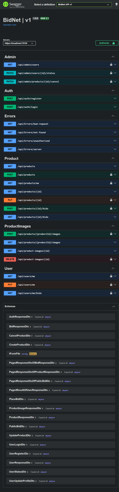 | `01-swagger-overview.png` — toàn bộ 21 endpoint + schemas, nút Authorize |
| 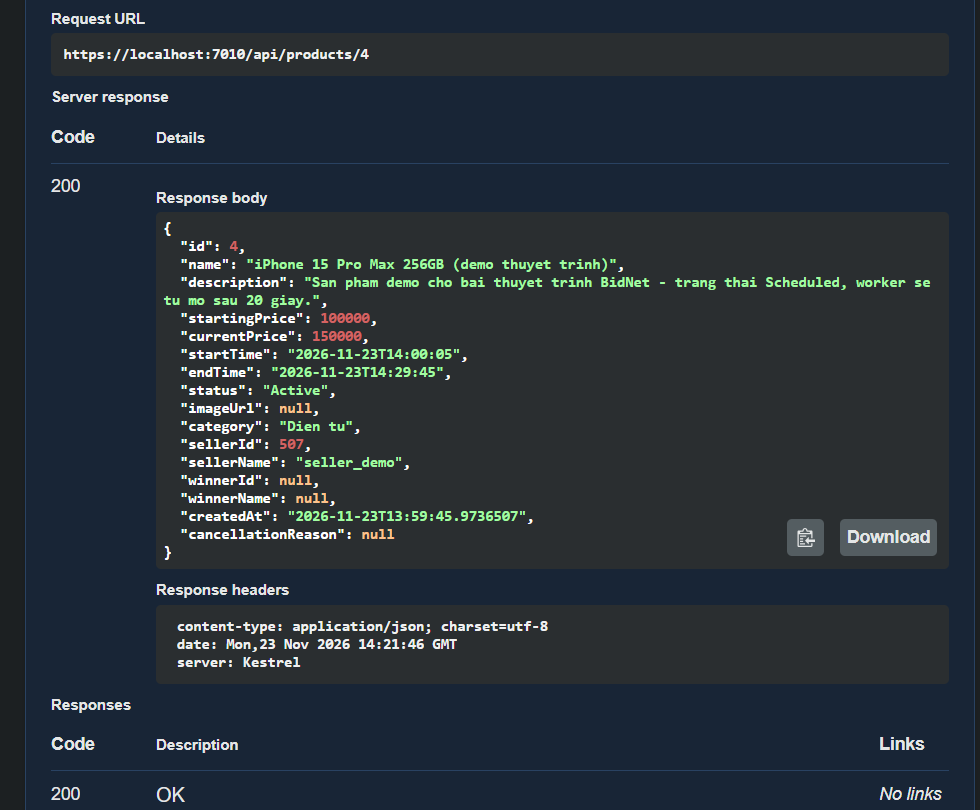 | `02-product-4-response.png` — GET /api/products/4: status Active, currentPrice 150.000, winnerId null |
| 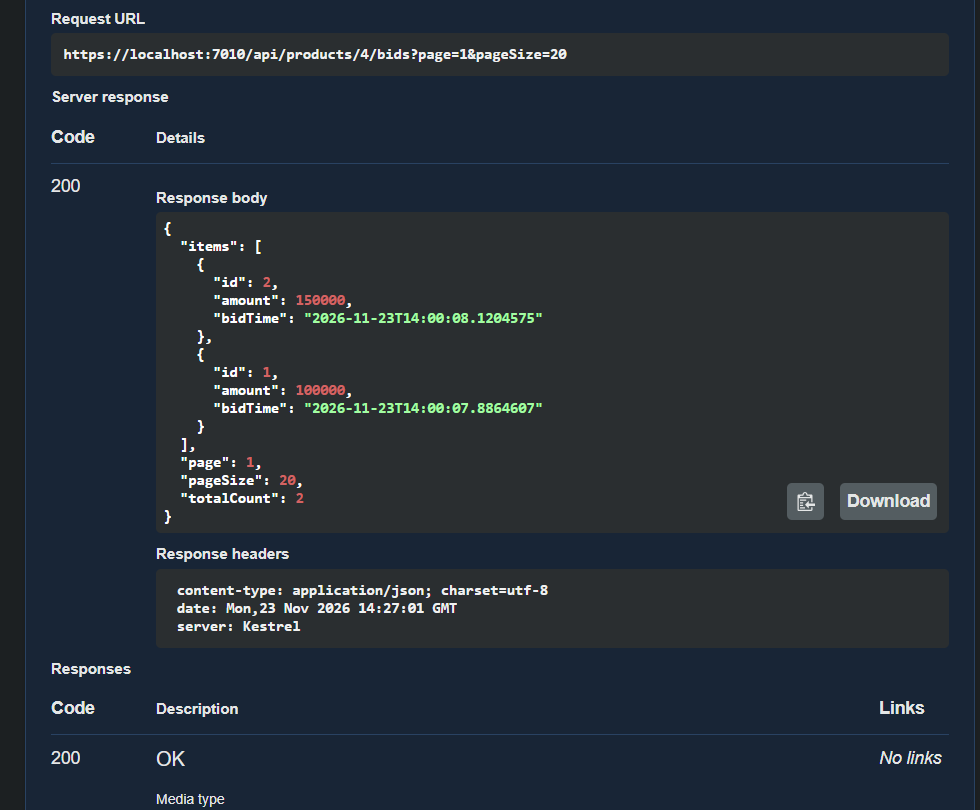 | `03-bid-history-public.png` — GET /api/products/4/bids: 2 lượt giá, **không lộ UserId**, kèm phân trang |

---

## 12. Q&A — Câu hỏi giảng viên hay hỏi + trả lời

**Hỏi: Vì sao dùng JWT thay vì session/cookie?**
Trả lời: REST API stateless — server không lưu trạng thái đăng nhập, mọi thông tin (Id, Role) nằm trong token đã ký HMAC-SHA256. Nhiều client (web, mobile, SignalR) dùng chung một cơ chế. Đánh đổi: không thu hồi token tức thì được → bù bằng `RequireActiveAsync` đọc DB mỗi hành động nhạy cảm.

**Hỏi: Mật khẩu lưu thế nào? Vì sao không SHA-256 thường?**
Trả lời: PBKDF2-SHA256, 210.000 vòng lặp, salt ngẫu nhiên 16 byte, hash 32 byte (`AuthService.cs:144`). SHA-256 thường quá nhanh → brute-force GPU dễ; PBKDF2 cố tình chậm. Salt chống rainbow table và chống 2 user cùng pass ra cùng hash. So sánh bằng `FixedTimeEquals` chống timing attack.

**Hỏi: Hai người đặt giá cùng lúc thì sao? (câu quan trọng nhất)**
Trả lời: Optimistic concurrency với `rowversion`. EF đưa RowVersion cũ vào WHERE của UPDATE; request đến sau khớp 0 dòng → `DbUpdateConcurrencyException` → 409 `bid_conflict`, transaction rollback, không ghi đè. Bid + CurrentPrice luôn trong một SaveChanges nên không có trạng thái nửa vời. Có test SQL thật chứng minh (`SqlConcurrencyTests`).

**Hỏi: Vì sao dùng optimistic mà không pessimistic (lock)?**
Trả lời: Đọc nhiều ghi ít, xung đột hiếm → không giữ lock DB, không chặn request khác, scale tốt hơn. Khi xung đột thì trả 409 để client tải lại — trải nghiệm đấu giá vẫn đúng vì giá chỉ tăng.

**Hỏi: Worker cập nhật trạng thái chậm 5 giây, lỡ đặt giá lúc phiên chưa mở/đã đóng?**
Trả lời: BidService không tin Status hiển thị — kiểm tra trực tiếp `StartTime <= now < EndTime` bằng giờ server UTC (BR-04/08). Trạng thái chỉ là nhãn; cửa sổ thời gian mới là chân lý.

**Hỏi: Người thắng xác định thế nào? Hòa giá thì sao?**
Trả lời: `OrderByDescending(Amount).ThenBy(BidTime).ThenBy(Id)` — cao nhất thắng, bằng giá thì đặt sớm hơn thắng, Id phá hòa cuối. Không có bid → WinnerId null (BR-15).

**Hỏi: Worker chạy lại/nhiều instance có đóng phiên 2 lần?**
Trả lời: Mỗi lượt đọc lại trạng thái trước khi ghi; chỉ phiên còn Active mới đóng; RowVersion chặn ghi đè; conflict thì detach chờ lượt sau. Kết quả cuối chỉ ghi một lần (BR-16). (Nhiều instance thật sự cần phối hợp thêm ở DB — đặc tả mục 7 ghi nhận là việc tương lai.)

**Hỏi: Vì sao phát SignalR SAU SaveChanges?**
Trả lời: Tránh báo cho client một bid chưa commit (có thể rollback) → client thấy giá ảo. Lỗi gửi SignalR chỉ log warning vì bid đã lưu thành công, trả lỗi HTTP sẽ khiến client gửi lại → bid trùng.

**Hỏi: Client mất mạng rồi kết nối lại, dữ liệu lệch thì sao?**
Trả lời: DB là nguồn sự thật. Reconnect xong client gọi `GET /api/products/{id}` tải lại toàn bộ trạng thái/giá mới nhất.

**Hỏi: Admin khóa tài khoản, token họ còn hạn 60 phút thì có dùng tiếp được?**
Trả lời: Không. Mọi hành động nhạy cảm (đặt giá, đăng bài, sửa, hub join) gọi `CurrentUser.RequireActiveAsync` đọc DB kiểm tra IsActive → 403 ngay. Login mới cũng bị chặn.

**Hỏi: Vì sao người bán không được tự đặt giá?**
Trả lời: BR-07 — chống tự nâng giá ảo (shill bidding). Kiểm tra `product.SellerId == user.Id` → 403.

**Hỏi: Vì sao tiền dùng decimal?**
Trả lời: decimal(18,2) biểu diễn chính xác hệ 10; float/double sai số nhị phân tích lũy. API còn bắt buộc số nguyên VND (BR-10) — chặn số thập phân bằng `decimal.Truncate`.

**Hỏi: Vì sao không xóa sản phẩm/user cứng?**
Trả lời: Giữ lịch sử đấu giá và toàn vẹn FK (Restrict). Admin hủy mềm (Cancelled + lý do), khóa mềm (IsActive). Không có cascade vòng.

**Hỏi: DTO để làm gì, sao không trả thẳng entity?**
Trả lời: Chống lộ trường nhạy cảm (PasswordHash/Salt, RowVersion, Balance), chống over-posting (client gửi SellerId/Status/CurrentPrice — server bỏ qua, tự quyết định). Lịch sử công khai dùng PublicBidDto ẩn UserId.

**Hỏi: Xử lý lỗi thống nhất thế nào?**
Trả lời: Nghiệp vụ ném `ApiException(status, code, message)`; middleware ngoài cùng bắt mọi exception, map về JSON `{statusCode, message, detail, traceId, timestamp}`; 500 không lộ stack trace (trừ Development); traceId đối chiếu log Serilog. Lỗi ngoài controller (401/429…) có StatusCodePages bồi ProblemDetails.

**Hỏi: Vì sao Authentication đứng trước RateLimiter?**
Trả lời: Policy "bid" partition theo username — phải xác thực JWT trước mới biết user; nếu đứng sau, chỉ đếm được theo IP, một người spam vẫn lọt.

**Hỏi: Chống trùng username/email khi 2 request đồng thời?**
Trả lời: Kiểm tra trước chỉ để trả lỗi đẹp; chốt chặn thật là unique index trong SQL — request thứ hai nhận SqlException 2601/2627, bắt và đổi thành 409.

**Hỏi: Ảnh lưu ở đâu, vì sao không lưu DB?**
Trả lời: File trên Cloudinary (CDN), DB chỉ lưu metadata (PublicId để xóa, Url để hiển thị). DB không phình, ảnh phục vụ nhanh, transform auto quality/format. Validate MIME whitelist + 5MB + quyền chủ sở hữu trước khi upload.

**Hỏi: Test InMemory có đủ chứng minh concurrency không?**
Trả lời: Không — InMemory không thi hành rowversion. Nhóm tách test `StaleBid` chạy SQL Server thật, opt-in bằng biến môi trường, tạo/xóa DB tạm GUID riêng.

**Hỏi: Hệ thống chịu tải/spam thế nào?**
Trả lời: Rate limit fixed-window (auth 10/phút/IP, bid 30/phút/user, 429 không queue), phân trang bắt buộc ≤100, AsNoTracking cho đọc, index đúng cột worker quét, lô 50 phiên/lượt, CORS 1 origin, HTTPS.

**Hỏi: Điểm hạn chế của hệ thống? (chủ động nói trước khi bị hỏi)**
Trả lời: (1) Chưa có thanh toán/đặt cọc — Balance chưa dùng; (2) chưa có frontend trong repo; (3) worker 5s → độ trễ mở/đóng tối đa 5s (đã bù bằng kiểm tra giờ trực tiếp); (4) nhiều instance cần phối hợp DB thêm; (5) appsettings còn JWT key fallback mặc định — triển khai thật phải thay bằng secret riêng; (6) package System.Security.Cryptography.Pkcs 9.0.11 có cảnh báo vulnerability NU1902/NU1903 khi build — cần nâng cấp phiên bản vá.

---

## 13. Kịch bản thuyết trình gợi ý (~12–15 phút)

| # | Slide | Nói gì (tóm tắt) | Thời lượng |
|---|---|---|---|
| 1 | Tiêu đề | Tên đề tài, thành viên, công nghệ chính | 30s |
| 2 | Bài toán & phạm vi | Sàn đấu giá: 1 phiên = 1 sản phẩm = 1 người thắng; v1 làm gì, KHÔNG làm gì (thanh toán) | 1 phút |
| 3 | Kiến trúc | Chiếu `architecture.svg`: request đi Controller → Service → DbContext → SQL; worker + hub chạy song song | 1.5 phút |
| 4 | Database | Chiếu `erd.svg`: 4 bảng, decimal cho tiền, unique index, RowVersion, Restrict | 1.5 phút |
| 5 | Vòng đời phiên | Chiếu `state-machine.svg`: Scheduled→Active→Completed, Admin→Cancelled; worker 5s | 1 phút |
| 6 | Xác thực | Chiếu `auth-flow.svg`: PBKDF2 210k vòng, JWT 60 phút, RequireActive đọc DB mỗi lần | 1.5 phút |
| 7 | **Đặt giá + concurrency** | Chiếu `bid-sequence.svg`: 10 bước, nhấn UPDATE...WHERE RowVersion, 409, một SaveChanges | **2.5 phút** |
| 8 | Worker & người thắng | Chiếu `worker-flow.svg`: lô 50, chọn bid cao nhất/sớm hơn, idempotent | 1.5 phút |
| 9 | Realtime | Chiếu `realtime.svg`: nhóm auction:{id}, chỉ phát sau commit, reconnect tải REST | 1 phút |
| 10 | Bảo mật & lỗi | Chiếu `pipeline.svg`: thứ tự middleware, rate limit, traceId, ErrorsController demo | 1 phút |
| 11 | **DEMO TRỰC TIẾP** | Swagger: login → tạo phiên → chờ worker mở → đặt giá → ca lỗi 403/400 → khóa tài khoản → 403 ngay | 2–3 phút |
| 12 | Kiểm thử | 11 test; StaleBid chạy SQL thật vì InMemory không có rowversion | 30s |
| 13 | Hạn chế & hướng phát triển | Chủ động nêu 6 hạn chế ở mục 12 + hướng v2 (thanh toán, ví, đấu giá tự động) | 30s |
| 14 | Kết luận + Q&A | Tóm tắt 3 điểm mạnh: concurrency đúng, vòng đời tự động, realtime sau commit | — |

**Mẹo demo:** chạy `demo-data.ps1` trước để có sẵn phiên Active; khi thuyết trình tạo thêm 1 phiên mới với StartTime = +30s để cả lớp **nhìn thấy worker tự mở phiên** và giá đổi sau mỗi bid. Mở sẵn 2 cửa sổ Swagger (seller/bidder) để chiếu song song.

### 13.1 Bản PowerPoint 10 slide (đã tạo sẵn)

File `BidNet-ThuyetTrinh-10-slide.pptx` gồm đúng 10 slide, mỗi slide có **Notes (ghi chú người nói)** — khi trình bày bật *View → Notes Page* hoặc chế độ Presenter View. Bản này đã được rút gọn theo góp ý: trên slide chỉ còn **ý chính + sơ đồ**, phần giải thích chi tiết và các số liệu kỹ thuật nằm trong Notes.

| # | Slide | Nội dung trên slide | Hình / thành phần |
|---|---|---|---|
| 1 | Giới thiệu đề tài | BidNet + tên đề tài + 4 ô công nghệ (Backend, Database, Realtime, Authentication) + người thực hiện/lớp | 4 chip công nghệ |
| 2 | Bài toán & mục tiêu | 2 thẻ vai trò (Người bán / Người mua), 4 mục tiêu v1, dòng "Chưa triển khai: thanh toán, đặt cọc, ví điện tử" | 2 thẻ + 4 chip mục tiêu |
| 3 | Công nghệ & kiến trúc | Client → Controller → Service → EF Core → SQL Server; nhánh Background Worker / SignalR / Cloudinary | Sơ đồ vẽ trực tiếp trên slide (không dùng ảnh nhỏ) |
| 4 | Thiết kế cơ sở dữ liệu | 4 thẻ bảng Users / Products / Bids / ProductImages + 4 cơ chế bảo vệ dữ liệu | 4 thẻ bảng + 4 chip |
| 5 | Vòng đời phiên | SCHEDULED → ACTIVE → COMPLETED, nhánh Admin hủy → CANCELLED; chip 5 giây / 50 phiên | Sơ đồ trạng thái |
| 6 | Xác thực & phân quyền | 3 bước Đăng ký → Đăng nhập → Truy cập API; chip PBKDF2 210.000 vòng, JWT 60 phút; hộp "Điểm bảo mật" | 3 thẻ bước + 2 chip số liệu |
| 7 | Đặt giá & chống tranh chấp | Quy trình 5 bước + dải A/B/RowVersion/409 Conflict | 5 thẻ bước + sơ đồ tranh chấp |
| 8 | Realtime & bảo mật | Trái: A/B/C → SignalR Hub → nhóm auction:{id} → BidAccepted/AuctionClosed. Phải: bảng 5 lớp bảo mật | Sơ đồ realtime + bảng |
| 9 | Demo thực tế | 2 ảnh Swagger thật, chip giá 100.000đ → 150.000đ, 4 badge 201/403/400/200 | `screenshots/02`, `03` |
| 10 | Kiểm thử & kết luận | Khối lớn 11/11 TEST PASSED + 3 kết quả nổi bật + hạn chế + "XIN CẢM ƠN!" | Khối số liệu + 3 thẻ |

**Số liệu kỹ thuật vẫn được giữ trong Notes** để trả lời phản biện: PBKDF2 210.000 vòng + salt 16 byte, JWT HMAC-SHA256 hạn 60 phút, worker 5 giây/lần và 50 phiên, bước giá 1.000 VND, RowVersion, SignalR chỉ phát sau commit, rate limit 10/phút/IP và 30/phút/user, 11/11 test, 4 bảng + 4 migration.

Muốn sửa nội dung: chỉnh `make-pptx.ps1` rồi chạy lại (cần Microsoft PowerPoint đã cài). Lưu ý file `.ps1` phải lưu **UTF-8 có BOM** thì PowerShell 5.1 mới đọc đúng tiếng Việt. Các sơ đồ trên slide 3, 4, 5, 6, 7, 8 được vẽ trực tiếp bằng shape nên không phụ thuộc ảnh; riêng slide 9 dùng ảnh chụp thật trong `screenshots/`.

---

## 14. Tài liệu tham chiếu trong repo

- `README.md` — hướng dẫn chạy máy mới, secrets, test, realtime.
- `docs/BidNet-Backend-Specification.md` — đặc tả nghiệp vụ BR-01…BR-17, hợp đồng API, tiêu chí nghiệm thu (mục 10).
- `BidNet.http` — các request mẫu.
- `Logs/log-*.txt` — log thật của các lần chạy (có traceId của demo hôm nay).
